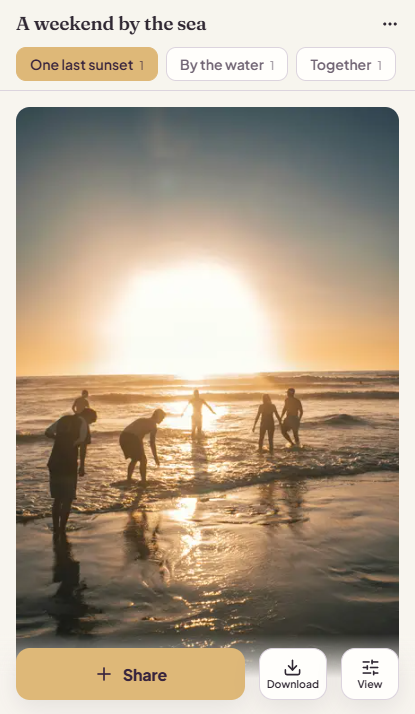

# Mira

**Everyone’s photos. One shared album.**

Mira is a self-hosted photo and video album for trips and get-togethers. Bring
everyone’s memories together without chasing contributions across group chats.
Share a link or QR code, let guests contribute without creating an account, and
download what you want to keep.

**Open source. Hosted by you. No guest accounts or app installation required.**

[How it works](#bring-everyones-photos-together) · [Host your own](#host-your-own-mira) ·
[Deployment guide](docs/DEPLOYMENT.md)



## Bring everyone’s photos together

The trip is over, but the photos are still scattered across phones and chat
threads. Mira gives your group one place to contribute, browse, and revisit them.

1. **Create an album.** Sign in and give your trip or gathering a home.
2. **Invite your group.** Share a link or QR code. Guests join from their browser
   without creating an account.
3. **Collect everyone’s perspective.** Add photos and videos, and group them into
   moments such as the walk, the lunch, or the sunset.
4. **Keep the good stuff.** Mark favourites and download selected items, a person’s
   contributions, or the whole album as a ZIP.

Owners can let uploads appear immediately or review them before the group sees
them. Photos and videos are kept exactly as uploaded, untouched originals with their
date and location. Large videos also get a small copy that the album plays, so a
1 GB clip starts at once from a copy of under 100 MB. Whoever downloads chooses
between the original and the small copy, for one video or a whole ZIP. An owner who is short of disk can choose to keep only the
small copies. Mira also supports installation as a progressive web app.

## Hosted by you

Run Mira on your own server with your own media storage and PostgreSQL database.
You choose where the albums live and manage updates, storage limits, and backups.
The code is available under the [MIT license](LICENSE).

Owners sign in to create and manage albums across devices. Guests have
device-based access. Anyone with an invitation link can join, so share links
deliberately; upload approval controls contributions, not who joins.

## Host your own Mira

For a production instance, you’ll need Docker, persistent storage, an HTTPS reverse
proxy, and an administrator password or configured sign-in provider for owners. Follow the
[deployment guide](docs/DEPLOYMENT.md) for configuration, initial setup, and backups.

To try the app locally with Docker:

```sh
docker compose -f compose.dev.yaml up
```

Open `http://localhost:5180`. This is a development environment with hot reload;
use the production guide for an instance you share with others.

## Develop locally

Mira uses SvelteKit, TypeScript, PostgreSQL, Drizzle, and sharp. With Node 24 and a
local PostgreSQL database:

```sh
cp .env.example .env
npm ci
npm run db:init
npm run dev
```

Configure your local database and sign-in settings in `.env`; see
[`.env.example`](.env.example). For local development only, `MIRA_DEV_AUTH=1`
enables the development login. Never enable it on a production instance.

See [CONTRIBUTING.md](CONTRIBUTING.md) for development checks and the production
boot smoke test.

## Project website

The [public website source](site/index.html) tells the Mira story and includes a
self-hosting walkthrough. It is a separate static site, ready for GitHub Pages;
the album application requires its own server.

[Deployment and GitHub Pages guide](docs/DEPLOYMENT.md) · [Source on GitHub](https://github.com/Humalio/mira)

## Status

Mira 0.1.0 is its first release. It installs into a fresh database, and there is
no automatic upgrade from earlier development builds, so read the
[release notes](docs/RELEASES.md) before replacing a running copy. Until the 0.1.0
image is published on the [releases page](https://github.com/Humalio/mira/releases),
[build the image from this repository](docs/DEPLOYMENT.md#building-the-image-yourself).

## License

[MIT](LICENSE). Website photography and fonts have their own credited licenses in
[the website credits](site/credits.html).

See [GitHub releases](docs/RELEASES.md) for versioned Docker images and release notes.
